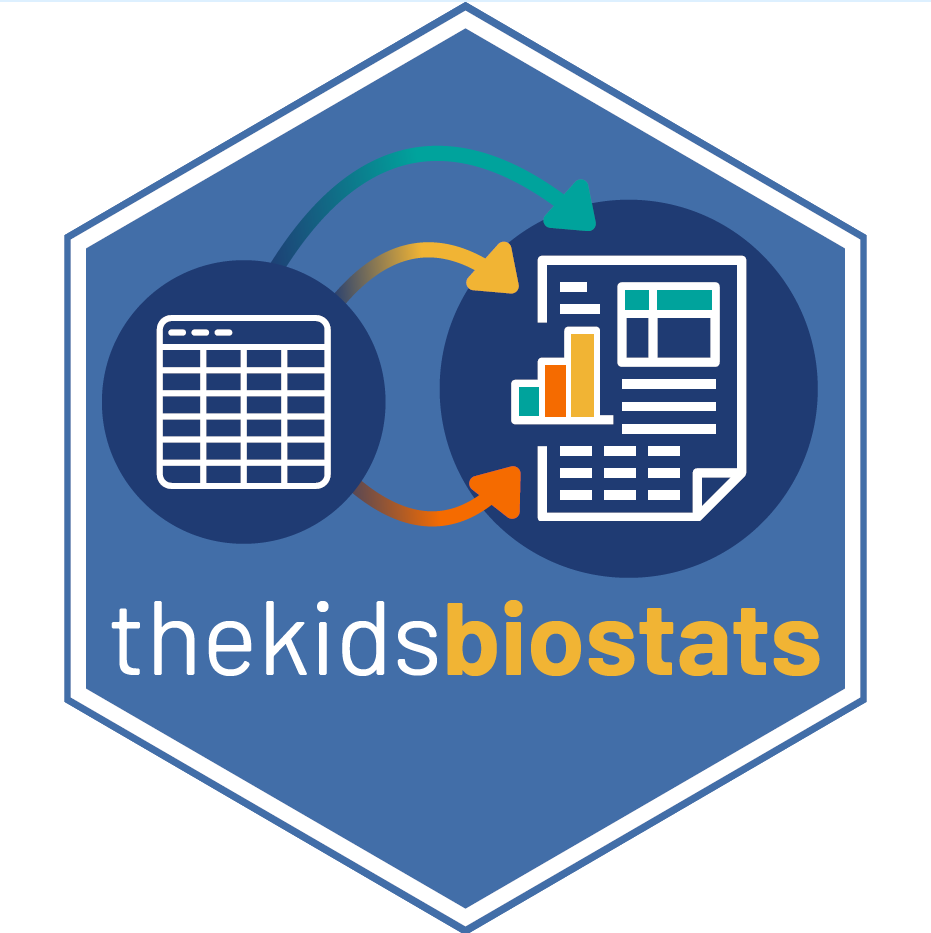

```{r}
#| include: false
library(thekidsbiostats)
```

# Package Demo

This document contains a walkthrough for using the [`thekidsbiostats` R package](https://github.com/The-Kids-Biostats/thekidsbiostats) to faciliate/standardise the common tasks performed in a typical statistical analysis from initialising a project to generating a formatted report.

## Step 0: Installing the Package

First, run this code in an R session to install the package.

```{r}
#| eval: false

install.packages("thekidsbiostats", repos = "https://the-kids-biostats.r-universe.dev", dependencies = TRUE)
```

... or if you have the `remotes::` package installed.

```{r}
#| eval: false

remotes::install_github("The-Kids-Biostats/thekidsbiostats")
```

We also need to ensure Barlow is installed such that R can see it

```{r}
#| eval: false
#| 
extrafont::font_import()
```

<br>

Now load the package into your R session

```{r}
#| eval: false

library(thekidsbiostats)
```

## Step 1: Creating a Project

There are two ways to create a new "project" (i.e. a directory structure for use in either RStudio or Positron):

1.  Use the Shiny app, which features an interactive interface to create a project. Open the app from the Addins menu in RStudio, or by running the code below in the R console:

```{r}
#| eval: false

thekidsbiostats::create_project_addin()
```

<br>

2.  Alternatively, you can bypass the interactive app and run the code below, entering the relevant parameters manually:

```{r}
#| eval: false

thekidsbiostats::create_project(
  project_name = "demo", # required
  path = "your/path/", # required
  folders = c("data", "admin", "scripts", "reports"), # optional
  create_report = TRUE, # optional
  open_project = TRUE # optional
)
```

<br>

::: {.callout-tip collapse="true"}
## open_project = TRUE

If you have opted for `open_project = TRUE` (the default), a new RStudio (or Positron) window will automatically open with your new project ready for you.
:::

<br>

## Step 2: Create a Report Template

If you chose not to create a report template in the previous project creation stage, you can also do so manually. In the same way as *Create Project*, this can be done in two ways:

::: column-margin
Remember to run `library(thekidsbiostats)` if you have started a new R session.
:::

1.  With the Shiny app, found either in the Addins menu or by running the code below in the console:

```{r}
#| eval: false

thekidsbiostats::create_template_addin()
```

<br>

2.  Directly in the console, entering the relevant parameters manually.

```{r}
#| eval: false

thekidsbiostats::create_template(
  file_name = "my_report", # requried
  directory = "reports", # optional
  ext_name = "html", # optional
  title = "My report", # optional
  subtitle = "for the demo", # optional
  author = "My Name", # optional
  affiliation = "The Kids Research Institute Australia", # optional
  include_reproducibility = TRUE, # optional
  open_file = TRUE # optional
)
```

This creates a ready-to-go Quarto document for your project. Try pressing "Render" in RStudio, or "Preview" in Positron. The folder that contains your Quarto document should also now contain an HTML document, complete with The Kids branding and the title, subtitle, author(s) and affiliation(s) you specified, as well as some precompleted text (which can easily be changed).

> Everything we do from now on will be entered into R chunks within your Quarto document (`xyz.qmd`).

<br>

## Step 3: Load Data

<br>

Let's go ahead and load some data.

You'll notice there is already an R code 'chunk' where we loaded `thekidsbiostats`. Beneath that, let's load some example data by inserting and running the following code:

```{r}
#| echo: fenced

data(patients_raw, package = 'thekidsbiostats')

```

Let's inspect the data to see what we're working with.

```{r}
#| eval: false

View(patients_raw)

```

<br>

## Step 4: Cleaning Column Names

Column names like `Height (cm)` or `Diabetes (Y/N)` are all too common in real-world datasets, but are a hassle to work with in R. We would need to surround them with backticks (\`s) each time we reference them due to the spaces and special characters. However, they are visually nicer than `patient_id` and `height_cm` when viewed in a plot or table.

> How can we get the best of both worlds?

The answer lies with assigning **label** attributes to each column, which is made easy with the functions in `thekidsbiostats`:

1.  `make_column_dict`
2.  `update_columns` (and `relabel_columns`)

Let's start with creating a *column dictionary* that will be referenced when renaming and giving labels to our dataset. Run this in the R console:

```{r}
#| eval: true

make_column_dict(patients_raw)
```

You'll notice this prints a chunk of preformatted code. Highlight this code, and copy it to your clipboard (Ctrl+C).

Create a new code chunk (shortcut: Ctrl+Alt+I) in your Quarto report underneath where you loaded the data, then paste the code into the chunk. It should look like this:

```{r}
dict_patients_raw <- tribble(
  ~old, ~new, ~label,
  "Patient ID", "patient_id", "",
  "Site Name", "site_name", "",
  "trt_grp", "trt_grp", "",
  "randomisation date", "randomisation_date", "",
  "AGE_yrs", "age_yrs", "",
  "Sex", "sex", "",
  "Height (cm)", "height_cm", "",
  "WEIGHT_kg", "weight_kg", "",
  "Do you smoke any form of tabacco product?", "do_you_smoke_any_form_of_tabacco_product", "",
  "Diabetes (Y/N)", "diabetes_y_n", "",
  "Cholesterol-Total", "cholesterol_total", "",
  "eGFR", "e_gfr", "",
  "HR_bpm", "hr_bpm", "",
  "SBP_baseline_mmHg", "sbp_baseline_mm_hg", "",
  "DBP Baseline (mmHg)", "dbp_baseline_mm_hg", "",
  "sbp.wk12", "sbp_wk12", "",
  "DBP_Week12", "dbp_week12", "",
) 
```

Each line specifies *three* important values for each variable:

1.  `old`: The original ("old") name in the dataset
2.  `new`: The "new: name we want to replace it with.

- Automatically generated for each variable, replacing whitespace with underscores and removing special characters. This may be sufficient in many cases, but we'll manually adjust some ourselves.

3.  `label`: A place to give the variables a 'human-readable' label for displaying in tables and plots. More often than not these need to be manually entered.

- As an aside, AI is a very useful tool here for performing a first pass at assigning the labels.

Let's write some `new` variable names and give a `label` to each one.

```{r}
#| echo: fenced

dict_patients_raw <- tribble(
  ~old, ~new, ~label,
  "Patient ID", "patient_id", "Patient ID",
  "Site Name", "site", "Site name",
  "trt_grp", "treatment", "Treatment Group",
  "randomisation date", "rand_date", "Randomisation Date",
  "AGE_yrs", "age", "Age (years)",
  "Sex", "sex", "Sex",
  "Height (cm)", "height_cm", "Height (cm)",
  "WEIGHT_kg", "weight_kg", "Weight (kg)",
  "Do you smoke any form of tabacco product?", "smoking_status", "Smokes Tobacco Product",
  "Diabetes (Y/N)", "diabetes", "Diabetes",
  "Cholesterol-Total", "chol_total", "Cholesterol Total",
  "eGFR", "egfr", "eGFR",
  "HR_bpm", "heart_rate", "Heartrate (BPM)",
  "SBP_baseline_mmHg", "sbp_baseline", "SBP Baseline (mmHg)",
  "DBP Baseline (mmHg)", "dbp_baseline", "DBP Baseline (mmHg)",
  "sbp.wk12", "sbp_week12", "SBP 12w (mmHg)",
  "DBP_Week12", "dbp_week12", "DBP 12w (mmHg)",
) 
```

Let's run that code to store the dictionary, and then create a new chunk.

<br>

In the new R chunk, simply run the following to update the columns:

```{r}
#| echo: fenced

patients_clean <- update_columns(data=patients_raw, dict=dict_patients_raw)
```

Now, if you `View(patients_clean)`, you'll notice that the new column names have been applied. If you are in RStudio, you'll also notice the labels are also apparent in the data viewer. In Positron, you must hover over a variable name to see its label.

In any case, the data is now ready for some preliminary analysis.

<br>

## Step 5: Creating a Table.

We'd now like to generate a classic "Table 1" to inspect our patient demographics by treatment group. We'll use `gtsummary::tbl_summary()` for this, before applying our own stylistic adjustments to the table.

::: column-margin
Notice that the `tbl_summary` function worked out of the gate, we did not need to load the `gtsummary` package using `library(gtsummary)`.

**This is because `thekidsbiostats` loads many of the packages we use on a day-to-day basis, including `tidyverse`, `gtsummary` and `flextable`!**
:::

```{r}
#| echo: fenced

table1 <- tbl_summary(
  patients_clean,
  by = treatment,
  include = c(
    "site", "age", "sex", "height_cm", "weight_kg", "smoking_status", "diabetes"
  )
) |> add_p()

table1
```

The table above looks *fine*, but ultimately we want to make it consistent with the aesthetic of the rest of the report in terms of fonts, colours and minimalism. This can be done in one simple command:

```{r}
#| echo: fenced

thekids_table(table1)
```

The output is itself a `flextable` object that already looks great, but we can modify it further if we wish with any `flextable::` function.

<br>

Additionally, some common changes to the *row labels* are also possible through the `modify_labels()` function which ships with `thekidsbiostats`.

For example, perhaps we want to add horizontal lines between variables and bold them to more easily distinguish them from each other and their sublevels.

```{r}
#| echo: fenced

thekids_table(table1) |> 
  modify_labels(hline = T, bold = T)
```

Some customisation is also possible within `thekids_table()` using various parameters. Let's use some of these parameters to:

1.  Change the colour to "Saffron"
2.  Highlight the Perth row (perhaps that is of particular interest)
3.  Increase the font size to 11 from the default 10
4.  Increase the header font size to 12 from the default 11
5.  Decrease the padding to 2 from the default 2.5
6.  Modify the row labels to be bolded and be separated with a horizontal line (hline)

```{r}
#| echo: fenced

thekids_table(
  table1,
  colour = "saffron",
  highlight = 4, # highlight_colour = thekids_colours$pumpkin_50,
  fontsize = 10,
  fontsize_header = 12,
  padding = 2
) |> 
  modify_labels(hline = T, bold = T)
```

::: column-margin
Note that the variable names are labelled automatically thanks to our hard work above using `update_columns`!
:::

<br>

## Step 6: Creating a Plot

Let's suppose we wish to compare the Systolic Blood Pressure at the 12-week follow up between treatment groups. We might want to do this with a favourite combination of ours: **a jitter plot on top of a boxplot on top of a violin plot.**

Let's do this as basically as possible in a new chunk:

```{r}
#| fig.height: 4
#| fig.width: 6
#| echo: fenced

plot1 <- ggplot(aes(x = treatment, y = sbp_week12, fill = treatment), data = patients_clean) +
  geom_violin(alpha = 0.5, trim = FALSE) +
  geom_boxplot(width = 0.3, alpha = 0.7) +
  geom_jitter(width = 0.1)

plot1
```

As we've pointed out in previous talks (with tongue in cheek) nothing screams 'my first ggplot' like these default colours, background, and font.

Let's instantly give the plot a The Kids' aesthetic using a couple of functions from `thekidsbiostats`

```{r}
#| fig.height: 4
#| fig.width: 6
#| echo: fenced


plot1 +
  thekids_theme(base_size = 12) +
  scale_fill_thekids()

```

We may notice that there appears to be a difference between the 10 mg/day group and the other two groups, and we want to bring that to the attention of the reader.

Quarto provides two particular features that we can use to draw attention:

1.  Callouts
2.  Column Margins

We have seen both being used troughout this guide already.

::: callout-tip
## Callouts

A **callout** is a highlighted box that sits within the flow of the text. It is ideal for notes, tips, warnings, or a key finding you don't want the reader to miss. Callouts can also be collapsed (`collapse="true"`) so that supporting detail doesn't clutter the page.
:::

::: column-margin
A **column-margin** places text in the margin beside the main body of the report. This is perfect for short asides, such as a caveat or a pointer to the right part of a figure, without interrupting the main narrative.
:::

<br><br>

You could type the syntax for either by hand, but `thekidsbiostats` ships with shortcut addins that insert these for you. In Positron, open the Command Palette (Ctrl+Shift+P) and search for the addin by name; in RStudio they are found in the Addins menu. You can also call them from the console:

```{r}
#| eval: false

insert_callout()
insert_callout_2()
insert_margin()
```

Place your cursor where you'd like the new element to go in your Quarto document, run the addin, and the template code is inserted at the cursor, ready for you to fill in.

For example, let's draw attention to the 10 mg/day group with a callout, add the following to your Quarto document:

``` markdown
::: callout-note
## Lower blood pressure at 10 mg/day

At 12 weeks, systolic blood pressure appears lower in the 10 mg/day group than in the other two groups.
:::
```

And add a more subtle aside in the margin:

``` markdown
::: column-margin
This is a descriptive impression from the plot only; no formal comparison has been made yet.
:::
```

::: {.callout-tip collapse="false"}
## Tip

Callouts come in several types (`note`, `tip`, `warning`, `important` and `caution`) which determines their colour.
:::

<br>

### Choosing your own colours

`scale_fill_thekids()` is a quick way to apply the palette, but sometimes we want more control, for example to give each group a specific colour, or to make the group we're highlighting stand out. The named colours in `thekids_colours` can be passed to `scale_fill_manual()` to do exactly this.

Let's pick three colours manually, using Saffron for the 10 mg/day group we're drawing attention to:

```{r}
plot1 +
  thekids_theme(base_size = 12) +
  scale_fill_manual(
    values = c(
      thekids_colours$midnightblue,
      thekids_colours$teal,
      thekids_colours$saffron
    )
  )
```

The colours are assigned in the order of the factor levels of `treatment` (Control, 5 mg/day, 10 mg/day). To see every available colour name, run `names(thekids_colours)`, or use `thekids_showpalette()` to view the palettes.

## Step 7: Handy helper functions

`thekidsbiostats` also contains a few small functions that save time on everyday data wrangling.

### `fct_case_when()`

`dplyr::case_when()` is great for creating categories from a continuous variable, but it returns a character vector, so the categories are ordered alphabetically in tables and plots ("Healthy", "Obese", "Overweight", "Underweight"...). `fct_case_when()` works identically, but returns a factor whose levels are in the order you wrote the conditions.

Let's categorise our patients by body mass index (BMI):

```{r}
patients_model <- patients_clean |> 
  mutate(
    bmi = weight_kg / (height_cm / 100)^2,
    bmi_cat = fct_case_when(
      bmi < 25 ~ "Underweight/Healthy",
      bmi < 30 ~ "Overweight",
      bmi >= 30 ~ "Obese"
    )
  )
```

Notice that the resulting factor levels are printed to the console. This is deliberate, as the result is not always what you expect, and can be switched off with `message = FALSE`.

```{r}
count(patients_model, bmi_cat)
```

The categories now appear in a logical order, rather than alphabetically.

### `round_df()` and `round_vec()`

Rounding is something we do constantly, and it's easy to end up with many decimal places in a table. `round_vec()` rounds a single vector, while `round_df()` rounds every numeric column in a data frame at once.

```{r}
patients_model |> 
  group_by(treatment) |> 
  summarise(across(c(bmi, sbp_baseline, sbp_week12), mean)) |> 
  round_df(digits = 2, con_char = T)
```

```{r}
round_vec(mean(patients_clean$sbp_week12), digits = 1)
```

## Step 8: Running a model

Let's suppose we want to run a model comparing SBP at follow-up (week 12) by treatment, adjusted for baseline SBP (ANCOVA framework to adjust for baseline imbalance) and BMI category (the variable we just created with `fct_case_when`).

We can define the model as usual here:

```{r}
mod <- lm(sbp_week12 ~ treatment + sbp_baseline + bmi_cat, data = patients_model)
```

Then we can run `thekids_model_output()` to create a selection of ready-to-go tables and plots to describe the model.

```{r}
mod_output <- thekids_model_output(mod, by = "treatment")
```

The `mod_output` is a list of the following:

### Descriptive Table

```{r}
mod_output$mod_desc %>% 
  thekids_table()
```

### Descriptive Plot

```{r}
mod_output$mod_desc_plot +
  scale_fill_thekids() +
  scale_colour_thekids()
```

### Model Diagnostics

```{r}
mod_output$mod_diag
```

### Model Output from gtsummary::tbl_regression()

```{r}
mod_output$mod_output %>% 
  thekids_table()
```

The original data and model are also available in `mod_output$mod_dat` and `mod_output$model` respectively.

